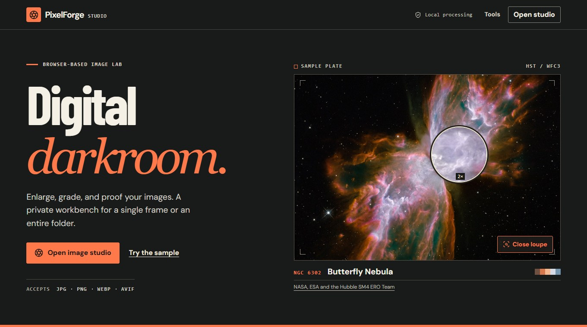
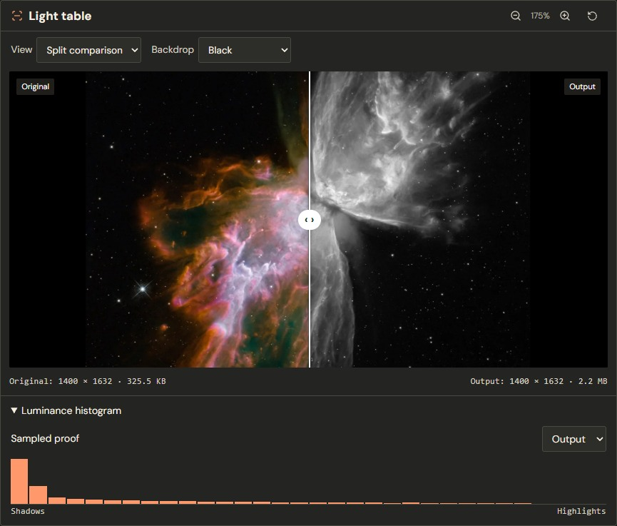
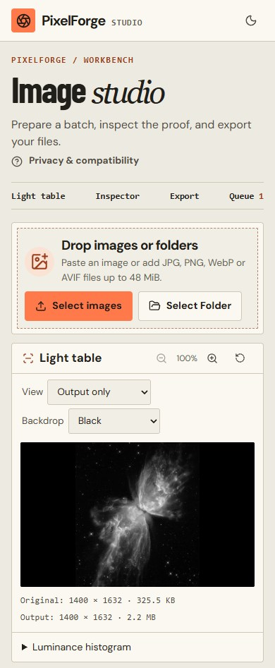
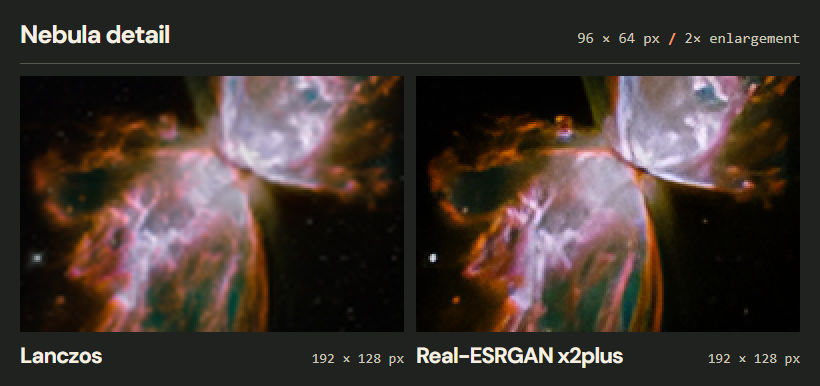
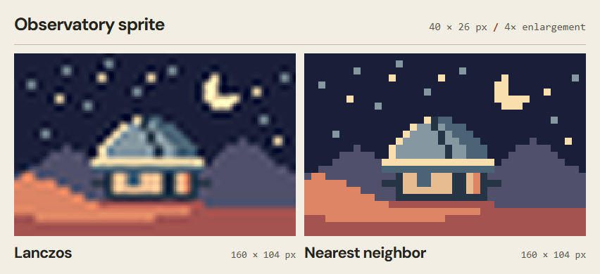

# PixelForge Studio

A browser-based darkroom for resizing, grading, upscaling, and proofing batches of images. Drop a folder, choose a recipe, and compare the encoded output with its original before downloading. Images stay on your device.

[](https://github.com/PRABHMANNAT/Pixel-Studio-Image-upscaler/actions/workflows/verify.yml)

[Make your first proof](#make-your-first-proof) · [Compare real exports](#compare-real-exports) · [File and batch limits](#files-privacy-and-limits)



## Make your first proof

Use Node.js 22 or later and npm.

```sh
git clone https://github.com/PRABHMANNAT/Pixel-Studio-Image-upscaler.git
cd Pixel-Studio-Image-upscaler
npm ci
npm run dev
```

1. Open the [local studio](http://localhost:3000/studio/). Paste an image, drop a folder, or choose **Use sample image** to work with the bundled Hubble photograph.
2. In **Inspector**, choose **Monochrome print**. It keeps the source dimensions and produces a grayscale PNG. **Planned output** shows the dimensions for the selected file.
3. Choose **Start batch**. Drag the light-table divider or focus it and use the arrow keys. Open **Luminance histogram** to inspect the original or output.
4. Download the file from its queue row. **Download all as ZIP** keeps nested folders, and **Download batch report** saves a CSV of filenames, dimensions, sizes, and statuses.



The **Monochrome print** recipe retains the original 1400 × 1632 dimensions. Zooming changes how closely you inspect the proof. Focus the zoomed image and use the arrow keys to pan.

<details>
<summary>View the mobile studio</summary>

<p>On a narrow screen, use <strong>Light table</strong>, <strong>Inspector</strong>, <strong>Export</strong>, and <strong>Queue</strong> to jump between sections. Here the light table displays the finished PNG on a black backdrop.</p>



</details>

## Choose the right processing method

| Method | Good fit | Behavior |
| --- | --- | --- |
| Fast Resize · Lanczos | Photographs, thumbnails, format conversion | Filters edges with premultiplied alpha. Choose **Original size** for conversion alone. |
| Fast Resize · Nearest neighbor | Sprites, pixel art, interface assets | Copies the nearest pixel. The **Pixel art 4×** recipe scales each pixel into a four-by-four block. |
| AI Upscale · Real-ESRGAN x2plus | Enhancing a small photograph | Runs a native 2× model pass, then resamples to the requested dimensions. Tries WebGPU and can fall back to WebAssembly. |

The first AI run downloads approximately 64 MiB of model weights from Hugging Face. The worker verifies their SHA-256 checksum and can reuse the browser cache. Fast Resize and all image controls run locally with the application assets. [Model provenance](docs/model.md)

### Compare real exports

**Photograph at 2×.** Follow the bright curved rim just above the center of the nebula. Lanczos gives it a soft transition. Real-ESRGAN draws a sharper edge in this crop. Both PNGs started with the same 96 × 64 pixels and were exported at 192 × 128, then displayed at the same magnification. [Get the nebula input PNG](docs/examples/nebula.png?raw=1)



**Pixel art at 4×.** Look at the crescent moon and the steps in the observatory dome. Lanczos blends neighboring colors. The **Pixel art 4×** recipe turns each original pixel into a solid 4 × 4 block. Both exports are 160 × 104. [Get the observatory input PNG](docs/examples/observatory.png?raw=1)



To reproduce a pair, import its input PNG and select **Studio defaults** under **Processing recipe**. Run **Fast Resize** at the indicated size. In the completed queue row, choose **Make new version**, then run **AI Upscale** at 2× for the photograph or **Pixel art 4×** for the sprite. Both exports stay in the queue.

## Workbench controls

| Task | Available controls |
| --- | --- |
| Bring images in | File or folder picker, nested folder drop, clipboard paste, and a built-in photographic sample |
| Compose | Center crop to 1:1, 4:5, 3:2, or 16:9. Rotate in quarter turns, mirror horizontally, and check the planned output dimensions. |
| Develop | Adjust exposure in EV, contrast, and saturation. Sharpen opaque details or select a matte color for transparent JPEG exports. |
| Repeat a look | Start with **Web delivery**, **Monochrome print**, or **Pixel art 4×**. Save one personal recipe on the device and recall it after a reload. |
| Inspect | Split, original-only, and output-only views. Zoom and pan, switch between checkerboard, black, and white, and inspect a sampled luminance histogram. The gallery sample also has a keyboard-operable 2× loupe. |
| Organize | Search filenames, filter by status, and sort by name or size. The batch processes in import order even when the displayed list is filtered. |
| Deliver | Append a filename suffix, download a result or a ZIP, and export a CSV report. **Make new version** queues the original again and retains the first export. |

Processing applies the centered crop first, followed by rotation and mirroring, optional AI enhancement, resizing, tone adjustments, sharpening, and encoding. The light table shows the completed export. For another treatment, make a new version and start a new batch.

## Files, privacy, and limits

| Item | Behavior |
| --- | --- |
| Formats | Still JPG, PNG, WebP, and AVIF, subject to browser decoding support. AVIF export can use the bundled libavif WebAssembly encoder. |
| Transparency | PNG, WebP, and AVIF support alpha. Enable **Allow background for JPG** and choose the matte when flattening transparent input. |
| One image | Up to 48 MiB, 24 megapixels, and 8,192 pixels per edge. The AI input limit is 3 megapixels after framing. The WASM AVIF encoder supports outputs up to 6 megapixels. |
| One batch | Up to 80 queued files and 256 MiB of completed outputs. The in-memory ZIP fallback supports 96 MiB. Compatible browsers can stream ZIPs to disk. |
| Reloading | Files and exports live in the tab. Preferences, the personal recipe, and cached model weights can persist on the device. |
| Browser | Use a modern browser with Web Workers, OffscreenCanvas, and image decoding support. AI requires HTTPS or localhost. Animated images, HEIC/HEIF, and metadata preservation are outside the supported workflow. |

The gallery loads Three.js on demand when the loupe opens. A CSS magnifier supplies the same interaction when WebGL is unavailable. The loupe respects reduced-motion preferences. [Architecture and privacy](docs/architecture.md)

## Verify and deploy

```sh
npm run lint
npm run typecheck
npm test
npm run build
npx playwright install chromium
npm run test:e2e
```

The production build writes a static site to `out/`. Run `npm run preview` to inspect that build locally, or import the repository into Vercel using the included configuration. Other HTTPS static hosts should serve the exported files with their correct MIME types, including the worker, WebAssembly, and font assets. [Production and real-model test instructions](docs/testing.md) · [Verification results](docs/verification.md)

## Credits

The sample is Hubble’s observation of NGC 6302, credited to **NASA, ESA and the Hubble SM4 ERO Team**. The bundled JPEG is resized from the original. The desktop and mobile proofs use a monochrome rendition. The 96 × 64 comparison input is a cropped, downsampled derivative of the same photograph. [Original photograph](https://esahubble.org/images/heic0910h/) · [ESA/Hubble usage terms](https://esahubble.org/copyright/) · [CC BY 4.0](https://creativecommons.org/licenses/by/4.0/)

The interface uses Barlow Condensed and DM Sans. Licenses for the fonts, Three.js, Motion, and bundled image runtimes are included in the repository. [Third-party notices](public/notices/)
