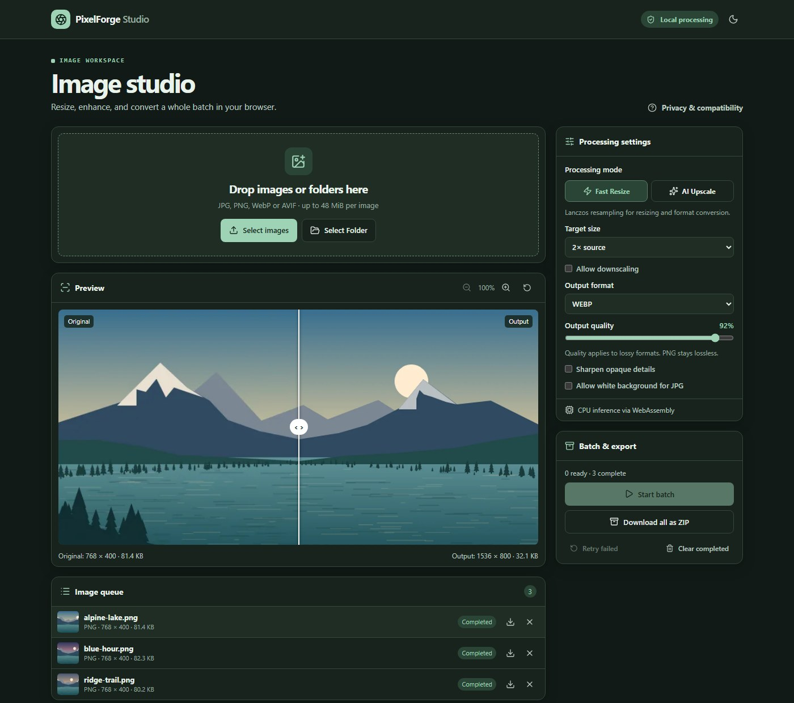

# PixelForge Studio

**Batch resize, convert, and AI-upscale images in your browser. Your photos stay on your device.**

Turn a folder of product photos into WebP, enlarge small assets with Real-ESRGAN, or fit a whole batch within the same size limits. Compare the results side by side, then download individual files or a ZIP that keeps your folder structure.

[](https://github.com/PRABHMANNAT/Pixel-Studio-Image-upscaler/actions/workflows/verify.yml)

[Run locally](#run-locally) · [Choose a mode](#choose-a-mode) · [Deploy](#deploy) · [Report a bug](https://github.com/PRABHMANNAT/Pixel-Studio-Image-upscaler/issues)



*The studio after converting a three-image batch to WebP.*

## What you can do

- **Resize entire folders.** Drop images or select a folder, then use a 2×, 4×, 2K, 4K, or custom size preset. The aspect ratio is preserved by default.
- **Convert between JPG, PNG, WebP, and AVIF.** Choose original size for conversion only. AVIF output uses the browser's encoder when available and falls back to libavif in WebAssembly.
- **Check the result before exporting.** Drag the before/after divider, zoom in for details, and compare dimensions and file sizes.
- **Manage longer batches.** See progress for each image, pause between files, cancel, or retry failures. Download one image or export the batch as a ZIP with nested paths preserved.

## Run locally

You'll need Node.js 22 or newer.

```sh
git clone https://github.com/PRABHMANNAT/Pixel-Studio-Image-upscaler.git
cd Pixel-Studio-Image-upscaler
npm ci
npm run dev
```

Open [the studio on localhost](http://localhost:3000/studio/), add files, choose a size and output format, and click **Start batch**.

## Choose a mode

| Mode | Best for | How it works |
| --- | --- | --- |
| **Fast Resize** | Bulk resizing and format conversion | Lanczos resampling preserves transparent edges. Optional sharpening adds definition to opaque details. |
| **AI Upscale** | Enlarging smaller images | Real-ESRGAN x2plus runs a native 2× pass. Other output sizes resample that result. The app tries WebGPU and falls back to WebAssembly. |

AI Upscale downloads and verifies a roughly 64 MiB model on first use. The browser can cache it for later runs. A Web Worker handles image decoding and model inference, and your browser creates the exports. No account or API key is required.

<details>
<summary>Supported files and batch limits</summary>

- **Inputs:** Static JPG, PNG, WebP, and AVIF, subject to browser decoding support. Animated images, GIF, SVG, HEIC, and HEIF are unsupported.
- **Transparency:** PNG, WebP, and AVIF can keep alpha. JPG requires your permission to flatten transparent areas onto a white background.
- **Per image:** Up to 48 MiB, 24 megapixels, and 8,192 pixels on either edge. AI inputs are capped at 3 megapixels, and the WASM AVIF encoder is capped at 6 megapixels.
- **Per batch:** Up to 80 queued images and 256 MiB of completed exports. Supported browsers can stream ZIPs to disk. The in-memory ZIP fallback is capped at 96 MiB.
- **On reload:** Settings and cached model weights can persist. The queue, source images, and processed files clear.

</details>

## Deploy

Import this repository into Vercel and deploy `main` with Node.js 22 or later. The included configuration builds and serves the static `out/` directory without environment variables. To preview the production build locally:

```sh
npm run build
npm run preview
```

You can also serve `out/` from another HTTPS static host that sends the correct content types for `.mjs` and `.wasm`.

## Development

PixelForge uses Next.js, TypeScript, Web Workers, ONNX Runtime Web, and fflate. Run the local checks with:

```sh
npm run lint
npm run typecheck
npm test
npx playwright install chromium
npm run test:e2e
```

[Architecture and privacy](docs/architecture.md) · [Model provenance](docs/model.md) · [Testing and AI smoke test](docs/testing.md) · [Delivery verification](docs/verification.md) · [Commit ledger](docs/commit-ledger.md)

If PixelForge helps with your image workflow, [give it a star](https://github.com/PRABHMANNAT/Pixel-Studio-Image-upscaler) so you can find it again.
